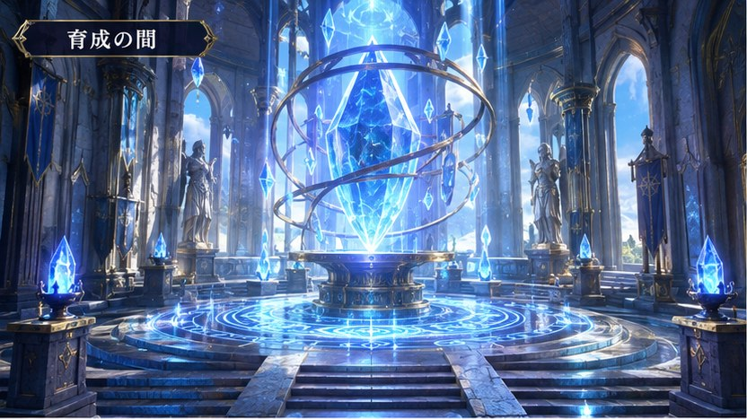

# オリキャラファイターズ (Original Character Fighters)

自分の画像からオリジナルキャラクターを作り、育てて、CPUと戦う **2D育成・対戦RPG**。
ゲーム設計・画面・キャラ作成・育成・戦闘・報酬・セーブまで、すべてゼロから構築されています。



## 遊び方

ローカルサーバーで `index.html` を配信するだけで動きます(ビルド不要)。

```bash
# 例: Python
python3 -m http.server 8000 --bind 0.0.0.0
# → http://localhost:8000 を開く
```

Node がある場合のロジックテスト:

```bash
npm test
```

## 主な機能

### 🖼️ オリキャラ画像(元画像をそのまま使用)
- PNG / JPEG / WebP などを読み込み(ファイル選択・ドラッグ&ドロップ)
- **ドット絵変換・AI描き直しは行わず、読み込んだ画像をそのままキャラクターとして使用**
- 元画像の顔・髪型・服装・色・細部の特徴を完全に維持
- 拡大・縮小(スライダー+数値表示)/ 位置調整(上下左右・中央配置・ドラッグ)
- 色彩の変更:明るさ / コントラスト / 彩度 / 色相 / 色温度(リアルタイム反映・非破壊)
- 左右反転 / 背景の透過(輪郭や服装は変更しない)/ 編集リセット / 元画像と比較
- 戦闘では縦横比を維持し、画像サイズ(小/中/大)を調整可能・高品質のまま表示
- 元画像・表示サイズ・位置・色彩・反転・透過設定を保存。画像を変更しても育成データは保持

### ⚔️ 育成・戦闘
- 8能力値(HP/MP/攻撃/防御/速度/魔力/命中/回避)+自由振り分け
- **22職業**(基本12 / 上級4 / 特殊6)、職業熟練度で上級職解放
- **215種類の技**(物理・魔法・回復・強化・弱体・防御・反撃・召喚・必殺)
- 属性相性(火>氷>風>雷>火 / 光↔闇)、状態異常、闘志ゲージ必殺技
- **覚醒5段階**(壱・弐・参・肆・極)+覚醒限定技
- Lv100で**転生**(永久全能力+5%/回)
- ターン制CPU戦。手動 / 自動 / 速度x1〜x3。Canvas演出(粒子・ダメージ数字・画面揺れ)

### ⚒️ 装備・ガチャ
- 武器7種(剣/斧/槍/弓/銃/杖/特殊)+防具/アクセサリー/装飾品
- **6レアリティ**(ノーマル/レア/エピック/レジェンダリー/ミシック/シークレット)
- 確率表示・天井(L+20回 / M+80回)・10連E以上確定
- 強化(+1〜+15)・合成(同レア3つ→1つ上位)
- 高レアリティは特殊効果付き。**ゲーム内コインのみ**(実課金なし)

### 🏯 5つの施設(添付画像を背景に使用)
1. **育成の間** — レベル・職業・技・覚醒・転生・見た目変更
2. **武器・装備工房** — 装備変更・ガチャ・強化・合成
3. **修行場** — トレーニング・技の練習・修行クエスト
4. **冒険者ギルド** — CPU対戦・ダンジョン・クエスト・交換所・戦績
5. **道具屋** — 回復/育成/覚醒素材・技の書の購入/売却

### 🏆 やり込み
- CPU対戦ランク(ビギナー〜神域)+ランク報酬・連勝ボーナス・特別強敵「修羅」
- ボス6体(撃破で限定技習得)+隠しボス「無名の王」
- ダンジョン5種(試練の洞窟〜深淵の塔+虚無の間)、進行保存
- デイリークエスト・実績48種・称号16種・図鑑(職業/技/装備/敵)+収集報酬
- 対戦ポイント交換所(限定技・素材・特別装備・称号)

### 💾 セーブ
- IndexedDB に自動セーブ(元画像・ドット絵・全進行状況)
- 書き出し / 読み込み(JSONバックアップ)
- PC / スマートフォン両対応(レスポンシブ)

## 技術構成
- 純粋な HTML / CSS / JavaScript(ES Modules)、ビルド不要
- 戦闘エンジンはDOM非依存で `test/logic.test.mjs` からテスト可能
- 日本語フォント(Noto Sans JP / Noto Serif JP)を同梱し、どの端末でも同じ品質で表示
- WebAudio による効果音・BGM(設定で音量調整)

## ファイル構成
```
index.html            画面シェル
css/style.css         全スタイル
js/
  main.js             起動・ルーター登録
  state.js            状態・育成・装備・報酬ロジック
  battle.js           戦闘エンジン(DOM非依存)
  battle-ui.js        戦闘画面(Canvas演出)
  image-edit.js       オリキャラ画像の非破壊編集(拡大/位置/色彩/反転/透過)
  sprites.js          CPU用プロシージャルスプライト
  audio.js            サウンド
  save.js             IndexedDBセーブ
  ui.js               共通UI・ルーター
  util.js             ユーティリティ
  data/               職業・技・装備・アイテム・敵・メタデータ
  screens/            各画面
assets/bg/            施設背景(添付画像から切り出し)
assets/fonts/         日本語フォント
test/                 ロジックテスト
```
